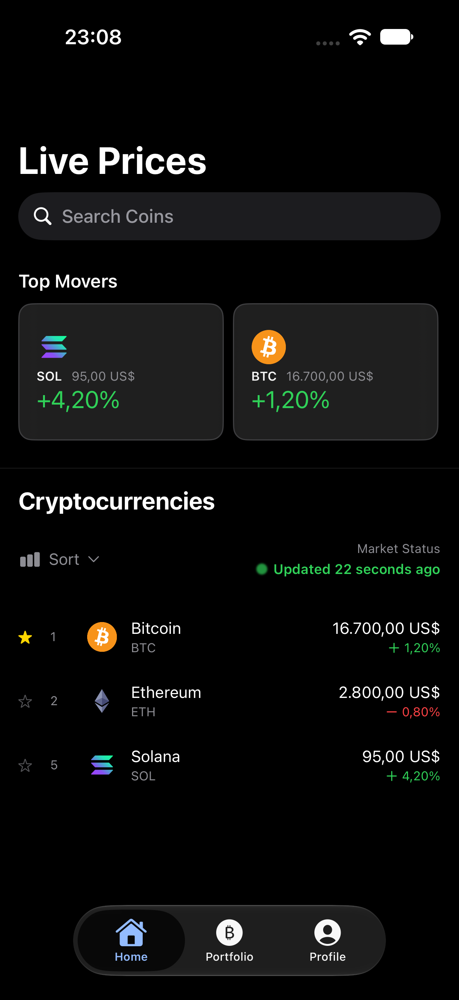
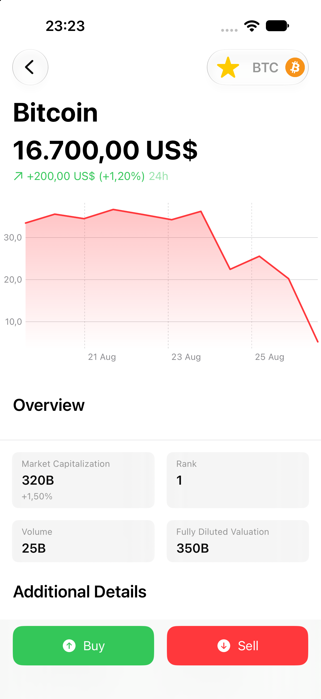
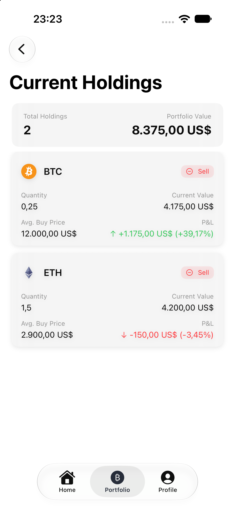
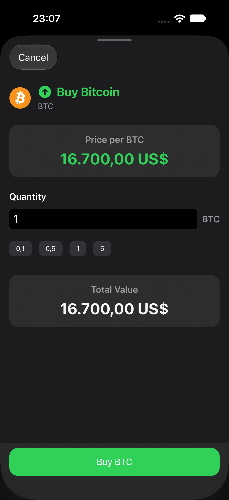
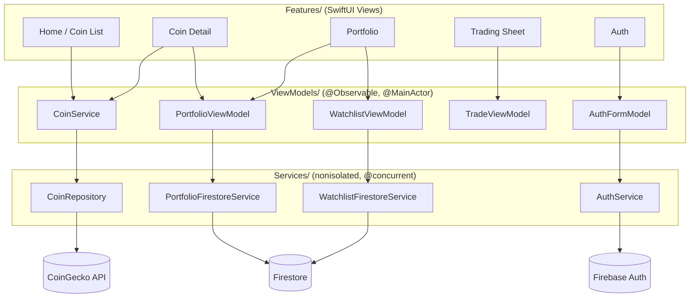

# CryptoApp

A native iOS app for tracking cryptocurrency prices and running a paper-trading portfolio — built with SwiftUI, Swift Concurrency, Firebase, and Swift Charts.

<p align="center">
  
  
  
  
</p>

## Features

- **Live market data** for the top cryptocurrencies (price, 24h change, market cap, volume) from the [CoinGecko](https://www.coingecko.com/en/api) API, with a "Top Movers" strip and search/sort.
- **Coin detail screen** with a 7-day price chart (Swift Charts), key stats, and a favorites star.
- **Paper trading**: buy and sell at the live price, with a quantity field, quick-pick chips, and validation against what you actually own.
- **Portfolio**: current holdings with average buy price and profit/loss, a distribution chart across your coins, and full transaction history.
- **Accounts** via Firebase Authentication (email/sign-up/sign-in), with per-user data in Firestore.
- **Offline-friendly**: cached prices are shown with a "saved prices" indicator when a refresh fails, instead of a blank screen.
- **Accessibility**: VoiceOver labels/values on every interactive element, Dynamic Type up to accessibility sizes, and Reduce Motion support.
- **Localized** in English and Polish (`Localizable.xcstrings`), including plural rules ("1 holding" vs "3 holdings").
- **Light / dark / system appearance**, chosen independently of the OS setting.

## Tech stack

- **UI**: SwiftUI, the [Observation](https://developer.apple.com/documentation/observation) framework (`@Observable`), native `TabView`/`NavigationStack`, Swift Charts.
- **Concurrency**: Swift 6 language mode, structured `async`/`await` throughout, main-actor-by-default isolation with `@concurrent` for network/Firestore/JSON work.
- **Backend**: [Firebase](https://firebase.google.com) Auth + Firestore (offline persistence enabled).
- **Networking**: `URLSession` against the CoinGecko REST API.
- **Images**: [Kingfisher](https://github.com/onevcat/Kingfisher) for coin icon loading/caching.
- **Testing**: [Swift Testing](https://developer.apple.com/documentation/testing) for unit tests, XCTest for one UI smoke test.

## Architecture

MVVM with a thin service layer, dependency-injected through `@Environment` — no singletons, no protocol for anything that has exactly one implementation.



- `CryptoAppApp` creates the four top-level services/view models once and injects them with `.environment(...)`; views read them with `@Environment(X.self)`, never `@StateObject`/`@Published`.
- `CoinService` holds the live coin list and is the single source of truth for prices — the coin detail and trade screens look coins up by id (`coinService.coin(id:)`) instead of carrying a snapshot, so a background refresh never leaves them showing a stale price.
- `PortfolioViewModel.buy`/`sell` write the transaction and the resulting holding in one Firestore batch, so a failed write can never leave local and remote state disagreeing.
- Only the I/O boundary (`CoinRepository`, the two Firestore services) is behind a protocol, so it can be swapped for a mock in tests and previews (see `App/SampleData.swift` and `CryptoAppTests/Support/`).

## Getting started

1. **Firebase project.** Create a Firebase project with Authentication (Email/Password) and Firestore enabled, then drop your own `GoogleService-Info.plist` into `CryptoApp/CryptoApp/` (the one in this repo is scoped to a personal dev project and its API key is restricted to this app's bundle ID — see [Security](#security) below).
2. **Firestore rules.** Deploy the rules in this repo so each user can only read/write their own data:
   ```sh
   firebase deploy --only firestore:rules,firestore:indexes
   ```
3. **Open and run.** Open `CryptoApp/CryptoApp.xcodeproj` in Xcode 26+, select the `CryptoApp` scheme, and run on an iOS 26+ simulator or device (⌘R). Swift Package Manager resolves Firebase and Kingfisher automatically.
4. **CoinGecko API.** The public CoinGecko endpoint is used with no API key; it's rate-limited, so avoid hammering pull-to-refresh in quick succession while developing.

### Running without a Firebase account

Launch with the `-uiTesting` argument (already wired up in `CryptoAppApp.init`) to run against in-memory sample data as a fake signed-in user — no network or Firebase project required. This is what the UI test and previews use.

## Tests

```sh
xcodebuild test \
  -project CryptoApp/CryptoApp.xcodeproj -scheme CryptoApp \
  -destination 'platform=iOS Simulator,name=iPhone 18 Pro'
```

Or press ⌘U in Xcode. There are unit tests (Swift Testing) covering coin decoding, `Decimal` price conversion, holding math, formatting, the coin service and repository (against a stubbed `URLSession`), the portfolio view model (against a mock Firestore service), and the trade view model — plus one XCTest UI smoke test that walks Home → search → coin detail → trade sheet (cancel) → portfolio → profile.

## Security

- `GoogleService-Info.plist` is committed, which is normal for a Firebase iOS app — it contains no secret, only a client identifier. It's only safe because:
  - the API key is [restricted](https://console.cloud.google.com/apis/credentials) to this app's bundle ID in Google Cloud, and
  - [`firestore.rules`](firestore.rules) enforces `request.auth.uid == userId` on every read and write, so a stolen key still can't read or write another user's data.
- For production use, also enable [Firebase App Check](https://firebase.google.com/docs/app-check) to make sure only genuine builds of this app can call Firebase at all.

## Roadmap

- [ ] Profile photo (`PhotosPicker` + persistence) — currently a static icon.
- [ ] Firestore App Check.
- [ ] Price a holding that has dropped out of the top-50 list instead of freezing its P&L at the purchase price.
- [ ] More locales.

## Project layout

```
CryptoApp/
  App/            App entry point, root view, tab bar, routing, sample/preview data
  Models/         Coin, Holding, Transaction, and other plain data types
  Services/       CoinRepository, AuthService, the two Firestore services (I/O boundary)
  ViewModels/     PortfolioViewModel, WatchlistViewModel, AuthFormModel, TradeViewModel
  Features/       One folder per screen: Home, CoinDetail, Trading, Portfolio, Profile, Auth
  DesignSystem/   Spacing/radius tokens, FormatStyles, shared small views
CryptoAppTests/       Unit tests (Swift Testing)
CryptoAppUITests/     One UI smoke test
```
